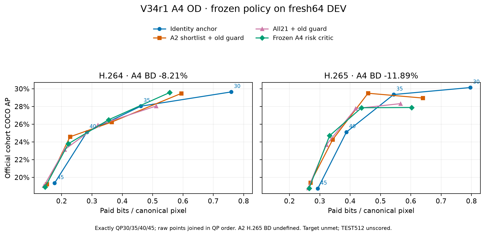

# V34r1 A4 OD: huấn luyện và kiểm chứng mới

## A4 OD: đã kiểm chứng trên64 ảnh DEV mới

Mô hình depth10/ngưỡng0,005 đã khóa trước khi suy luận64 ảnh, đủ10.752 hàng21 bộ lọc ×2 codec ×4 QP. Hai lần lặp anchor khớp packet/pixel; kiểm tra trạng thái detector ở cuối worker không đổi. Kiểm toán đối chiếu hash, đủ lưới,2.048 quyết định đã lưu, byte/header, tái sử dụng và các phép tính BD/resource đều qua.

| Phương pháp, cùng64 ảnh mới | H.264 | H.265 |
|---|---:|---:|
| A2 shortlist + guard cũ | −7,53% | Không xác định: không đơn điệu |
| Toàn21 bộ lọc + guard cũ | −5,37% | −9,82% |
| Critic A4 đã khóa | **−8,21%** | **−11,89%** |

**Chưa đạt−15%.** Cả hai đường critic tính được BD, nhưng điều kiện mở TEST cũng thất bại: utility H.264−0,11292 và H.265−0,06140, đều chưa thấp hơn log(.85)=−0,16252. Utility này không phải BD-rate. Không chỉnh mô hình/ngưỡng trên64 ảnh để gọi lại đó là xác nhận độc lập;512 ảnh TEST chưa đánh giá. Chưa có khoảng tin cậy BD cho phép đo64 ảnh này.

Kaggle chạy774,53 giây trên2 T4. Có10.538 lần encode và10.538 decode thật, gồm2 lượt lặp;10.499 forward detector trên bản giải mã,64 trên nguồn và512 forward controller A2. Các hàng trùng packet/pixel được ghi riêng;10.752 hàng logic không phải10.752 mẫu độc lập. Chi phí CPU phía gửi: tạo đặc trưng35,73 giây, critic0,47 giây, chọn/lưu0,33 giây; không cộng các timer lồng nhau. Tổng byte truyền luôn gồm40 byte header/gói.

OT A5 đã hoàn tất23 kiểm thử và chạy Kaggle CPU; calibration đạt−12,94%/−7,67%, chưa đạt mục tiêu. Nó kiểm tra bộ chọn theo log-bitrate cộng tổn hại HOTA nguồn, chỉ chọn lambda trên FIT rồi khóa trước một lần calibration cũ. Job này không mở TEST. AutoResearchClaw đã phản biện A5 thành công sau khi sửa bridge; không đổi cấu hình nghiên cứu theo kết quả calibration.

Bảng số gốc: [CSV](../results/v34r1_a4/od-fresh-dev/raw-curves.csv). Bằng chứng gốc Kaggle: [TGZ](../results/v34r1_a4/od-fresh-dev/v34r1-a4-od-fresh-dev.tgz).
