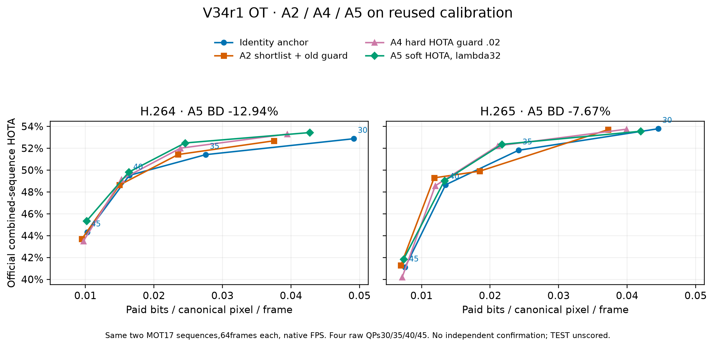

# V34r1 A5 OT

## A5 OT: đã đo, chưa đạt mục tiêu

Kaggle CPU chạy23 kiểm thử rồi phát lại7 lambda chỉ trên FIT. Quy tắc đã khóa chọn lambda32, utility FIT−0,31907; cả hai BD FIT của lựa chọn này không xác định vì đường không đơn điệu. Chính sách được lưu/hash trước một lần calibration cũ, không chọn lại theo calibration.

| OT trên cùng calibration cũ | H.264 | H.265 |
|---|---:|---:|
| A2 shortlist + guard cũ | −2,55% | −6,66% |
| A4 guard HOTA.02 | −8,23% | −9,94% |
| A5 log-byte + HOTA nguồn, lambda32 | **−12,94%** | **−7,67%** |

A5 cải thiện H.264 nhưng H.265 kém hơn A4; không có một cấu hình ở đây đạt cả hai dưới−15%. Không ghép riêng điểm tốt của A4/A5 thành kết quả phương pháp đã khóa. Đây là calibration tái sử dụng, không phải xác nhận độc lập; chỉ2 video ×64 frame và chưa có CI. Mỗi BD tích phân trên khoảng chất lượng chung của chính cặp đường tương ứng, được lưu trong JSON.

Cloud chạy333,05 giây, trong đó replay/metric279,05 giây; không encode/decode hay suy luận detector mới. Kiểm toán640 quyết định nguồn,32 tệp tracker anchor khớp byte với A3, toàn bộ metric tổng hợp/theo video và số học BD/FIT đều khớp. Tỷ lệ tổng byte A5/anchor trên calibration là0,90727 cho H.264 và0,93991 cho H.265; đây là tỷ lệ byte cùng lưới QP, không phải BD-rate. Chi phí tạo772 hàng cache gốc vẫn được khai báo riêng. Ba video TEST chưa suy luận hay chấm GT.

AutoResearchClaw đã phản biện A5 thành công sau khi sửa đường dẫn bridge; không đổi tham số nghiên cứu sau phản hồi. Phản biện nhấn mạnh utility khác BD, cỡ FIT nhỏ và yêu cầu phát lại lịch sử nhân quả riêng cho mỗi chính sách.

[Số gốc CSV](../results/v34r1_a5/ot-soft/raw-curves.csv) · [Bằng chứng Kaggle TGZ](../results/v34r1_a5/ot-soft/v34r1-a5-ot-soft.tgz)
