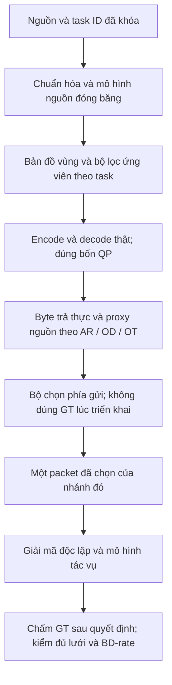
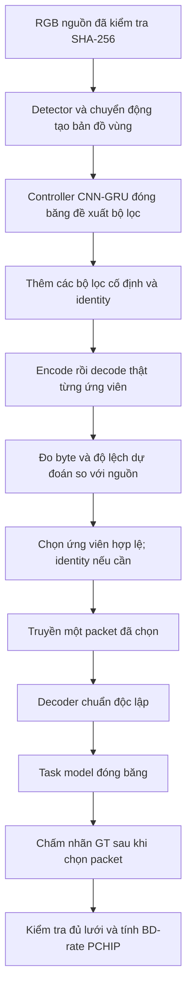

# Pipeline v34r1 hiện tại

Ba nhánh dùng chung cơ chế tiền xử lý, codec thật, tính byte/header và kiểm chứng; **chạy riêng theo tác vụ**, không phải một bitstream phục vụ đồng thời cả ba. Chỉ QP30/35/40/45, H.264/H.265. Mọi mô hình, codec, tracking và chấm GT thật đều chạy Kaggle. Laptop điều phối và kiểm toán số/tệp đã lưu.

| Nhánh | Luồng xử lý hiện tại | Bằng chứng mới nhất |
|---|---|---|
| AR | Kinetics →16 frame,128px → bản đồ vùng/shortlist CNN-GRU đóng băng → codec/decoder thật → guard KL/feature/top-1 → Video Swin-T → Top-1 | A2 TEST128: −31,35%/−21,22%; CI chưa xác nhận ngưỡng; chạy lại cùng dữ liệu không tăng cỡ mẫu |
| OD | COCO320px → Faster R-CNN đóng băng →21 bộ lọc → codec/decoder thật →302 đặc trưng không GT → critic ExtraTrees depth10/ngưỡng0,005 → chọn gói → COCO AP toàn cohort | A4 DEV64 mới: −8,21%/−11,89%; chưa đạt; không mở TEST512 |
| OT | MOT17 đúng FPS gốc → dự đoán nguồn/candidate đã lưu từ codec thật → ByteTrack trial cùng quá khứ → HOTA nguồn32 frame → chọn/commit một trial → TrackEval HOTA theo GT | A4 CAL cũ: −8,23%/−9,94%; A5 log-byte + lambda32×tổn hại HOTA nguồn: −12,94%/−7,67%, vẫn chưa đạt |

OD critic chỉ học FIT64; hai mô hình xuất và chính sách đã khóa trước DEV64 mới. OT A5 chỉ chọn một lambda từ bảy giá trị0,1,2,4,8,16,32 bằng FIT, rồi khóa trước một lần CAL cũ; job không đánh giá TEST. Calibration đã tái sử dụng được ghi rõ là phát triển. Các nhánh chưa dùng chung một mô hình critic đã huấn luyện.

Tất cả bốn điểm thô được giữ, đường không đơn điệu báo BD không xác định; không sửa điểm hoặc đổi QP để đạt−15%. Một lần tìm kiếm21 bộ lọc có thể tốn hàng nghìn encode/forward, được báo riêng với bitrate gói truyền. AR/OT dùng cửa sổ video; COCO hiện là ảnh intra, nên cấu hình theo task được công bố riêng.

Chi tiết mới: [tiến độ](V34R1-PROGRESS.md), [OD DEV mới](V34R1-A4-OD-FRESH-REPORT.md), [đề xuất thí nghiệm bài báo](V34R1-PAPER-PROTOCOL.md).

## Lượt A2 gốc để đối chiếu

Mã đo đã đóng băng: [`5a36901`](https://github.com/munnn01/test/commit/5a369016e4214b8339f89768534fed19cbcf194e). Benchmark chạy trên Kaggle. Laptop chỉ điều phối, tải log và kiểm toán kết quả, không chạy suy luận hay encode benchmark.

## Ba nhánh tác vụ

**AR:** K400 → đúng 16 frame/video, cỡ 128 → bản đồ vùng → ứng viên lọc → encode/decode thật → guard KL/feature/top-1 so với nguồn → packet → decoder → Video Swin-T → top-1 accuracy trên 128 video.

**OD:** COCO → ảnh cỡ 320 → Faster R-CNN tạo vùng object → ứng viên lọc → encode/decode thật → guard detection/feature so với nguồn → packet → decoder → Faster R-CNN ResNet-50 FPN → COCO AP trên toàn bộ 64 ảnh.

**OT:** MOT20 → cửa sổ 16 frame, cỡ 960 → bản đồ vùng → ứng viên lọc → encode/decode thật → guard tracking có snapshot → packet → decoder → Faster R-CNN + ByteTrack → TrackEval HOTA trên 256 frame. Mọi trial bắt đầu từ cùng quá khứ; chỉ trial được chọn mới commit, còn receiver của mỗi arm có lịch sử riêng.

GT chỉ được dùng để chấm sau khi packet đã được chọn. Cả ba nhánh dùng QP 30/35/40/45 trên H.264 và H.265. Sender thử tối đa 3 ứng viên học được, cộng 4 profile cố định theo tác vụ và identity; có thể ít hơn nếu ứng viên không qua điều kiện feasibility.

| Thành phần | Cấu hình đo |
|---|---|
| Codec | H.264/x264 và H.265/x265; preset medium |
| QP | Chỉ 30, 35, 40, 45 |
| Anchor | RGB chưa lọc; cùng kích thước, QP, codec và trọng số task model |
| Ứng viên | 13 profile cũ và 8 profile cố định mới; mỗi tác vụ thử một phần đã đóng băng |
| Guard | Chỉ dự đoán/đặc trưng nguồn sạch và byte đo thật; không đọc GT để chọn |
| Tracking | Mọi trial có cùng quá khứ; chỉ trial được chọn mới cập nhật trạng thái |
| Chi phí | Tính byte bitstream + header; ghi riêng số lần encode và thời gian thử ứng viên |
| AR | 128 video K400-val; 16 JPEG được chỉ định/video; Video Swin; top-1 |
| OD | 64 ảnh COCO2017 val; Faster R-CNN ResNet-50; COCO AP trên toàn tập |
| OT | MOT20-01, 256 frame đầu; Faster R-CNN + ByteTrack; TrackEval HOTA |
| Điều kiện đạt | Cả sáu tác vụ–codec đều có BD-rate hợp lệ và nhỏ hơn −15% |

AR dùng đầu vào cỡ128, OD320, OT960 theo cấu hình. Cadence gốc của JPEG K400 provider chưa được xác minh. Đoạn MOT20 là holdout nội bộ từ official train, chỉ có một sequence; không đại diện toàn bộ benchmark MOT20.

Đường chất lượng không đơn điệu, thiếu khoảng chất lượng chung hoặc thiếu điểm được giữ nguyên và báo không hợp lệ. Không bỏ QP, sửa đường hay đổi nội suy để đạt ngưỡng. Tiết kiệm byte ở cùng QP không thay thế BD-rate tại cùng độ chính xác.

AR đã chạy thành công 77 kiểm thử các khối; OD và OT đạt 75 kiểm thử ở commit trước hai test vận chuyển nguồn. Kiểm toán CPU đã xác nhận 104 tệp bằng chứng và đủ 3.328 hàng ghép cặp. Các packet được chọn trong lượt TEST này đều dùng identity hoặc profile cố định mới.

Kết quả: AR −31,35%/−21,22%; OD −7,84%/không hợp lệ; OT không hợp lệ/−16,08% (H.264/H.265). **Mục tiêu cả sáu endpoint dưới −15% chưa đạt**, và chưa xác nhận đồng thời bằng CI. Xem [báo cáo](V34R1-REPORT.md).

Đã dùng phản biện thiết kế thực tế qua AutoResearchClaw/ACP và các nguồn nghiên cứu chính thống. Chưa huấn luyện thêm một mạng preprocessing mới; các profile thêm là phép lọc cố định được thử bằng codec thật.

Tài liệu mã nguồn: [giao thức](https://github.com/munnn01/test/blob/v34r1/docs/V34R1.md), [kiểm chứng các khối](https://github.com/munnn01/test/blob/v34r1/docs/V34R1-VALIDATION.md), [nghiên cứu](https://github.com/munnn01/test/blob/v34r1/docs/V34R1-RESEARCH.md), [phản biện AutoResearchClaw](https://github.com/munnn01/test/blob/v34r1/docs/V34R1-AUTORESEARCHCLAW.md).
