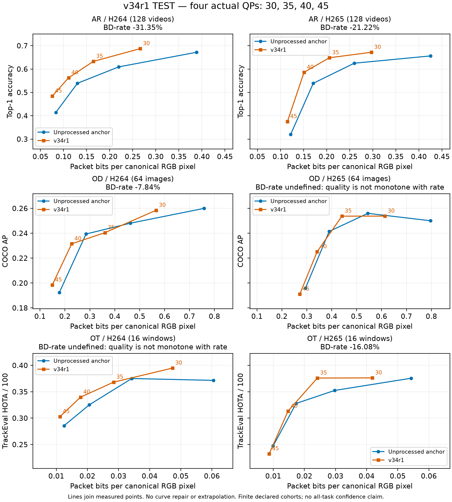

# Kết quả kiểm chứng v34r1

**Chưa đạt mục tiêu BD-rate < −15% đồng thời cho AR, OD và OT trên cả hai codec.**

| Tác vụ | H.264 | H.265 |
|---|---:|---:|
| AR | -31.35% | -21.22% |
| OD | -7.84% | Không hợp lệ: quality is not monotone with rate |
| OT | Không hợp lệ: quality is not monotone with rate | -16.08% |

`all_point_targets=false`; `all_thresholds_confirmed=false`.

BD-rate dùng PCHIP của log-rate trên khoảng chất lượng chung; chỉ QP30/35/40/45, không ngoại suy hoặc sửa đường. Giá trị âm là tiết kiệm byte tại cùng chất lượng tác vụ. Mọi endpoint không hợp lệ vẫn xuất hiện trong bảng và ngăn kết luận đạt đồng thời.

Hình nối các điểm thực đo, không làm trơn hay sửa đường. Trục x là tổng bit packet trên pixel RGB canonical; trục y lần lượt là top-1, COCO AP và HOTA/100. CSV giữ đủ 48 điểm.

## Bằng chứng thực thi

Toàn bộ TEST cuối chạy trên Kaggle, GPU T4×2, cùng Docker image và FFmpeg Linux7.0.2 đã ghim hash. Laptop chỉ điều phối, sao chép, kiểm toán và vẽ dữ liệu đã đo; các TEST Windows dở dang bị loại, không trộn vào đường cuối.

| Tác vụ | Nguồn giữ lại | Hàng ghép cặp | Thời gian đo, giây | Kiểm thử trên Kaggle |
|---|---|---:|---:|---:|
| AR | 128 video;16 frame/video | 2048 | 969.8 | 77 passed |
| OD | 64 ảnh COCO2017 val | 1024 | 260.7 | 75 passed |
| OT | 1 sequence MOT20-01;256 frame;16 cửa sổ | 256 | 2477.7 | 75 passed |

Thời gian đo gồm chuẩn bị nguồn tại sender, tìm ứng viên, mọi lần encode/decode thực và scoring; không gồm tải dữ liệu/trọng số và khởi tạo model. File COSTS ghi trial encode, tỷ lệ identity/profile cố định và thời gian; peak CUDA chỉ là số byte PyTorch cấp phát, không phải toàn bộ bộ nhớ GPU.

Chính sách A2 được đóng băng trước TEST. Namespace thuật toán và configs giữ nguyên giữa commit 5a36901 và bản sửa vận chuyển nguồn b3f30bc; log/protocol lưu hash thực tế để kiểm tra chéo. Các packet được chọn trong TEST đều dùng identity hoặc profile cố định mới; controller được giữ đóng băng.

AR chuyển từ mount provider 23 GB và tải lẻ lỗi HTTP sang bộ đệm Kaggle riêng tư gồm 3.053 JPEG, 43,8 MB. Từng byte khớp manifest đã đóng băng; ID, frame và label giữ nguyên. Archive nguồn SHA-256: `727e1b582943e77cdf509b0a27986af52bdb13a7d6dd046de2ad72fc03caac19`. Git chỉ chứa metadata/hash, mã và kết quả, không chứa media nguồn hoặc thông tin đăng nhập.

## Độ tin cậy và giới hạn

AR bootstrap ghép cặp theo video, 5.000 lần; draw không hợp lệ được trả vào đuôi bất lợi không hữu hạn. CI một phía điều chỉnh Bonferroni cho sáu endpoint. OD chưa có bootstrap AP đầy đủ, và OT chỉ có một sequence nên không thể xác nhận hiệu quả ở quần thể sequence. Kiểm thử mã và bằng chứng hiệu năng được đánh giá riêng.

| AR endpoint | CI lower | CI upper | Tỷ lệ draw hợp lệ |
|---|---:|---:|---:|
| H264 | Không hữu hạn | Không hữu hạn | 0.9860 |
| H265 | Không hữu hạn | Không hữu hạn | 0.7692 |

K400 TEST dùng128 ID official-val mới, loại holdout/controller/exclusions lịch sử; cadence gốc của JPEG provider chưa xác minh. COCO64 là cohort hữu hạn. MOT20-01 là holdout nội bộ từ official train, không phải bảng điểm challenge test. Không suy rộng kết quả này cho toàn bộ K400/COCO/MOT20.

Guard dùng dự đoán nguồn sạch và có thể giữ lỗi của model nguồn. AR top-1, COCO AP và HOTA đều được chấm bằng GT sau lựa chọn packet. Các profile mới là phép lọc cố định, không phải đầu ra mới của controller được huấn luyện.

AutoResearchClaw qua ACP đã phản biện thiết kế thật; CLI research đầy đủ trước đó dừng ở TOPIC_INIT. Phản biện và bài báo tạo giả thuyết, không thay thế các số liệu TEST trên.

## Hồ sơ tái lập

- [Mã và nhánh v34r1](https://github.com/munnn01/test/tree/v34r1).
- `results/v34r1`: protocol, paired rows nén, summary, tracking predictions, manifest hash, target report và log/notebook Kaggle.
- `scripts/verify_v34r1_results.py`: kiểm toán CPU hash, lưới, đường AR và phép tính BD-rate; không tuyên bố chạy lại detector hoặc chấm lại COCO/TrackEval.
- `V34R1-TEST-CURVES.csv`, `V34R1-ENDPOINTS.csv`, `V34R1-COSTS.csv`: bảng dữ liệu của báo cáo.
- Các DEV exploratory và thất bại được giữ riêng; không đổi chính sách theo TEST để trình bày một lượt đạt giả.
