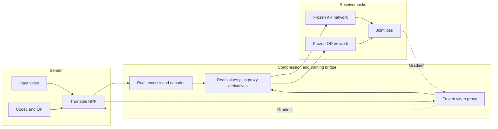

# Shared AR + OD with a real-codec video proxy

One causal neural preprocessor creates one RGB video, encoded once for both action recognition and object detection. Actual H.264/H.265 reconstructed pixels and elementary-stream bytes are used in the training forward pass; a learned recurrent proxy supplies reconstruction and bitrate derivatives. This is a runnable research pilot, not a claim of bitrate or accuracy improvement.



## Architecture and protocol

- NPP: pointwise branch plus compact U-Net/ConvGRU, codec/QP channel conditioning and a bounded residual initialized to identity.
- Proxy: conditional recurrent reconstruction with straight-through latent quantization, plus a positive content rate head with separate learned stream header bits. The rate head uses spatial Y/chroma detail and temporal differences with parameters for each codec/QP. The recurrent reconstruction sees past proxy reconstructions and resets at each clip/GOP boundary. The v1 logistic entropy head is retained only for baseline diagnostics.
- QP adaptation: a two-layer MLP produces feature scales from normalized QP and codec ID. One set of NPP weights serves exactly **QP 30, 35, 40, 45**, for both H.264 and H.265. The training schedule gives each source all eight codec/QP pairs; DEV evaluates all eight. QP 50 is excluded.
- Codec: closed GOP 16, no B frames or scene-cut insertion, `medium`, YUV420, 25 fps. All encoded frames are preserved. AR samples after decoding; OD operates on selected frames of the same decoded tensor.
- Tasks: frozen TorchVision R3D-18 Kinetics400 V1 and Faster R-CNN MobileNetV3 320 FPN COCO V1. Input normalization and detector training-loss mode retain input gradients while preventing weight and BN-statistic updates.
- Mixed labels: Kinetics uses AR GT CE plus source-logit consistency and source-detector pseudo boxes. COCO uses actual boxes, remains T=1, and has no AR loss. Detector supervision uses differentiable pre-NMS losses.

The bridge is `proxy + (real - proxy).detach()` for both video and rate. Merely adding real detached bitrate to a loss would supply no bitrate derivative. The joint loss combines rate, AR, OD, source consistency, RGB preservation and motion-gated temporal residual stability. Proxy weights are fitted first and frozen for NPP optimization; a refresh on current NPP outputs reduces distribution drift.

## Folder

| File | Responsibility |
|---|---|
| `ar_od_proxy/models.py` | NPP, ConvGRU, proxy and gradient bridge |
| `ar_od_proxy/codec.py` | Actual FFmpeg encode/decode and paid bytes |
| `ar_od_proxy/data.py` | K400/COCO loading, source-group splits, geometry |
| `ar_od_proxy/tasks.py` | Frozen pretrained differentiable task adapters |
| `ar_od_proxy/engine.py` | Proxy fitting, NPP fitting and checkpoints |
| `ar_od_proxy/evaluate.py` | Shared-stream predictions, official COCO AP and raw curves |
| `ar_od_proxy/calibration.py` | Train-only proxy calibration and paired DEV sensitivity diagnostics |
| `ar_od_proxy/run.py` | Real-data training, evaluation and clip encoding CLI |
| `ar_od_proxy/kaggle.py` | Immutable-source notebook preparation and redacted launcher |

## Install and check

Python >=3.10, compatible PyTorch/TorchVision, FFmpeg compiled with `libx264` and `libx265` are required. GPU training requires CUDA; local software tests use CPU and no pretrained-weight downloads.

```shell
pip install -e '.[dev,launch]'
python -m pytest -q
```

On a restricted Windows environment, point `TEMP` and `TMP` at a writable project temporary directory before running the tests. FFmpeg is also discovered beside a Conda environment under `Library/bin`.

## Train and evaluate real data

```shell
python -m ar_od_proxy.run train --config ar_od_proxy/configs/pilot.json --ar-root /data/kineticscleaned --coco-root /data/coco/val2017 --annotations /data/coco/annotations/instances_val2017.json --out outputs/pilot
python -m ar_od_proxy.run evaluate --checkpoint outputs/pilot/last.pt --config ar_od_proxy/configs/pilot.json --ar-root /data/kineticscleaned --coco-root /data/coco/val2017 --annotations /data/coco/annotations/instances_val2017.json --out outputs/recheck
python -m ar_od_proxy.run encode --checkpoint outputs/pilot/last.pt --input /data/video.mp4 --codec h265 --qp 40 --out outputs/encoded-clip
```

`encode` processes one centered contiguous 16-frame clip, the unit used by this experiment. A full-video/live-stream orchestration layer is outside this pilot. Output directories must be fresh. `--allow-cpu` explicitly permits local execution; Kaggle does not use this flag. Missing inputs, annotations, pretrained downloads or GPU fail explicitly.

The pilot config uses seed 20261022, width 12, RGB 256, 16 TRAIN sources per dataset and 8 DEV sources per dataset. Warmup has 512 proxy updates; NPP has 256 updates, covering every TRAIN source at every codec/QP pair. A 64-step proxy refresh occurs at NPP step 128. These are engineering starting values, not hyperparameters established by the reference paper.

Outputs include `manifest.json`, `training.jsonl`, `proxy_warmup.pt`, `last.pt`, `evaluation.jsonl`, all actual selected elementary streams, `coco_predictions.json`, `summary.json` and `run.json`. Checkpoints record source hashes and reject incompatible configurations. DEV curves report AR Top-1/Top-5, separate COCO mAP/AP-small, real bytes/bpp, timing, proxy reconstruction error and on-video OD source agreement.

## Kaggle

The launcher requests a **private free T4 GPU job** and mounts the existing datasets `qktttttttttt/kineticscleaned` and `awsaf49/coco-2017-dataset`. It downloads only this folder's allowlisted source files from an immutable public GitHub commit and verifies every SHA-256. External credentials never enter a notebook or published source.

```shell
python -m ar_od_proxy.kaggle prepare --account qktttttttttt --slug ar-od-proxy-qp4-20261022 --commit FULL_40_CHARACTER_COMMIT_SHA --directory outputs/kaggle-payload
python -m ar_od_proxy.kaggle submit --account qktttttttttt --slug ar-od-proxy-qp4-20261022 --directory outputs/kaggle-payload --pool /private/path/pool.json
python -m ar_od_proxy.kaggle status --account qktttttttttt --slug ar-od-proxy-qp4-20261022 --directory outputs/kaggle-payload --pool /private/path/pool.json
python -m ar_od_proxy.kaggle download --account qktttttttttt --slug ar-od-proxy-qp4-20261022 --directory outputs/kaggle-download --pool /private/path/pool.json
```

The notebook emits a cloud receipt and archives available outputs on failure as well as success. A submission acknowledgment is not evidence that training completed. Require `cloud_status.json.complete=true` and `run.json.complete=true` for completion.

## Scientific limits

Kinetics AR GT and COCO image OD GT do not constitute simultaneous AR+OD GT on the same video. Video detection agreement is consistency with a source detector, not mAP or proof of GT accuracy. Hash-defined DEV is separate from this NPP's TRAIN sources, but exposure of frozen pretrained task networks to original dataset training sources is not excluded. Previously used LAB data are not newly independent confirmation data.

Matching proxy reconstruction and rate does not prove its derivatives are faithful. Inspect rate-calibration diagnostics and verify any improvement with actual codecs on held-out data. The small pilot reports operating points without claiming BD-rate targets or statistical significance.

## Correct and audit a v1 proxy

The v1 entropy head's scale floor prevents it from representing most measured rates.
New checkpoints use format 2. Loading format 1 requires explicit migration and
calibration; the migration does not silently label random new head weights as fitted.
The calibration runner preserves the old NPP and proxy for paired comparisons:

```shell
python -m ar_od_proxy.calibration --checkpoint /data/v1/last.pt --ar-root /data/kineticscleaned --coco-root /data/coco/val2017 --annotations /data/coco/annotations/instances_val2017.json --out outputs/calibration
```

It fits 768 actual TRAIN rate targets (32 sources, eight operating points, three
paired blur/sharpen settings), uses 4000 rate updates and 1024 reconstruction
updates, then audits all 16 DEV sources at all eight points. Outputs include a
format-2 `calibrated.pt`, TRAIN targets, per-source `diagnostics.jsonl`, grouped
`summary.json`, and a completion receipt. Read [the protocol](docs/PROXY_CALIBRATION.md)
for definitions, finite-step tolerances and limitations. This evaluates finite
codec changes, without claiming an exact derivative of discrete coding decisions.

For Kaggle preparation add `--experiment calibrate --baseline-sha256 EXACT_SHA256`.
The calibration notebook mounts the previous pilot output and verifies the exact
baseline checkpoint bytes before fitting. Normal submission/status commands apply.

Architecture reference: [Preprocessing Enhanced Image Compression for Machine Vision](https://arxiv.org/abs/2206.05650). Temporal proxy context: [Sandwiched Video Compression](https://research.google/pubs/sandwiched-video-compression-an-efficient-learned-video-compression-approach/). This implementation is an adaptation with a different proxy and joint objective, not a reproduction of the reference's results.
